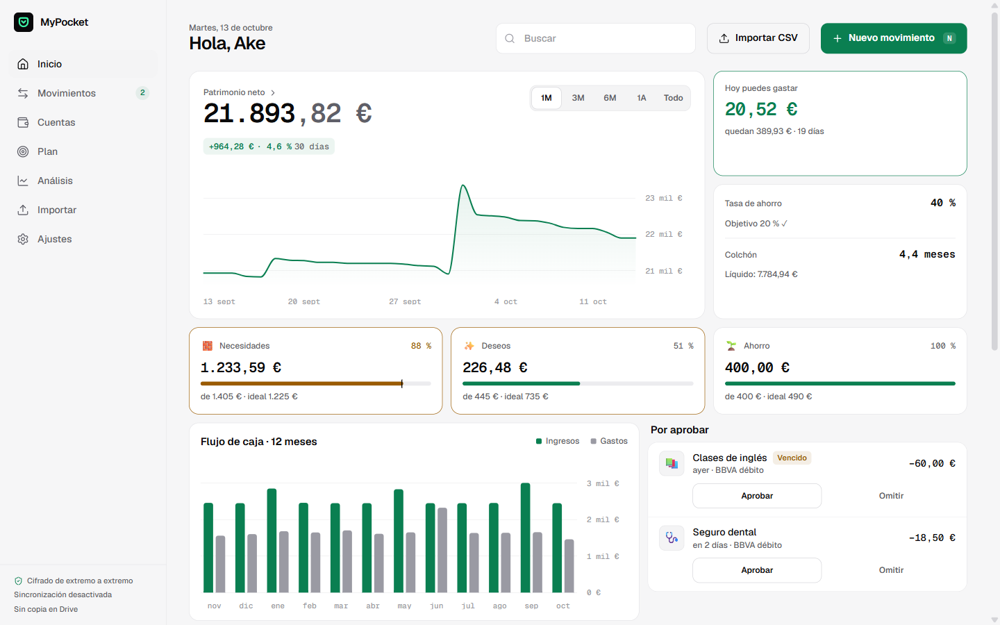
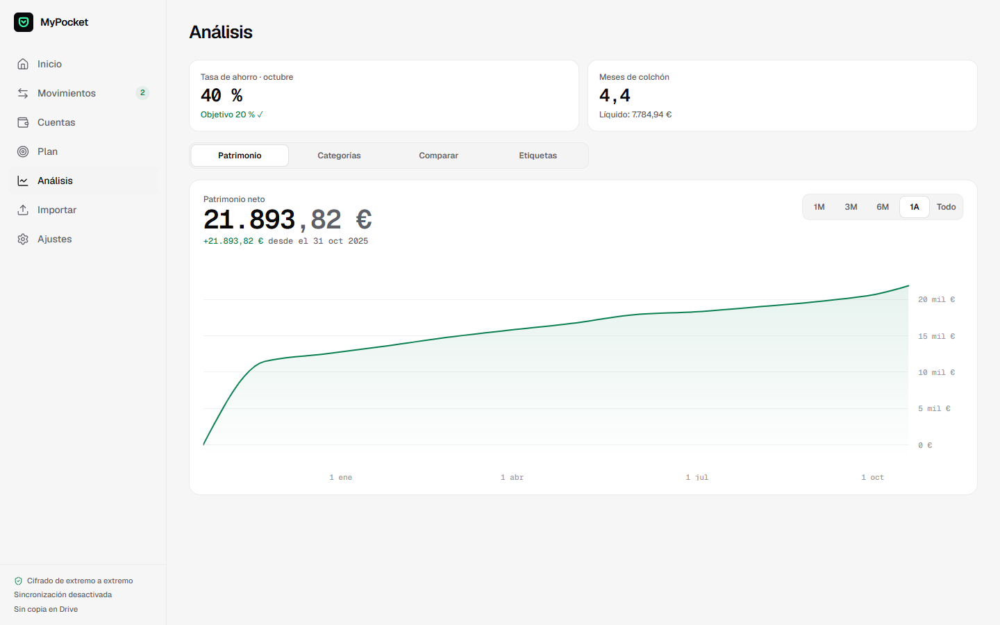

# MyPocket

A local-first, end-to-end encrypted personal finance app that runs entirely in the browser — no backend, no analytics, no bank APIs.

[](https://github.com/AketzaBarajas/mypocket/actions/workflows/ci.yml)
[](LICENSE)

**[Live app](https://mypocket-qzv.pages.dev)** · [Design decisions](docs/DECISIONES.md) · [Acceptance report](docs/INFORME.md)



## Overview

MyPocket is an installable PWA for tracking spending, budgets and net worth for a single user. All data lives in an encrypted SQLite database on each device and only leaves it as ciphertext, so the sync relay and the backup storage never see anything readable.

I built it to replace a Notion workbook I used for my own finances: I wanted to log an expense from my phone in a couple of taps, keep working offline, and not hand my financial data to a third party.

The interface and the internal documentation are in Spanish.

## Features

- **Fast entry:** an expense is logged in two or three taps, with rules that categorise it automatically.
- **Budgets and daily allowance:** needs / wants / savings groups, per-category budgets and a "you can spend today" figure derived from what is left of the month.
- **Net worth over time:** current, cash and investment accounts, with manual valuations for investments.
- **Recurring charges:** generated as pending movements that are approved or skipped.
- **CSV import:** column mapping, preview with bulk editing, and deduplication, so re-importing the same bank statement creates no duplicates.
- **Offline and multi-device:** works without a connection and syncs between phone, tablet and desktop.
- **Encrypted backups:** export to a file or to a private Google Drive app folder, restorable only with the recovery phrase.



## Tech stack

| Layer          | Technology                                                         |
| -------------- | ------------------------------------------------------------------ |
| UI             | React 19, TanStack Router, Tailwind CSS 4, Radix UI, Motion, visx  |
| Data and sync  | Evolu 8 (encrypted SQLite WASM on OPFS, CRDT sync through a relay) |
| Security       | WebAuthn passkeys (PRF), WebCrypto (AES-GCM, HKDF), strict CSP     |
| Language       | TypeScript 7 in strict mode, Zod for runtime validation            |
| Testing        | Vitest, Testing Library, Playwright                                |
| Build and host | Vite 8, vite-plugin-pwa, Cloudflare Pages                          |

## Getting started

Requires Node 24 LTS. pnpm is provided through Corepack.

```bash
corepack enable
pnpm install
cp .env.example .env.local
pnpm dev          # http://localhost:5173, starting at the real onboarding
pnpm seed:demo    # isolated demo profile with 12 months of fictional data
```

Google Drive backups, deployment and installing on an iPhone need a few manual steps, described in [docs/SETUP.md](docs/SETUP.md).

## Testing

```bash
pnpm typecheck    # TypeScript 7, strict
pnpm lint         # ESLint with type-aware rules, zero warnings allowed
pnpm test         # unit and component tests (Vitest)
pnpm test:e2e     # end-to-end tests against the production build (Playwright)
pnpm build && pnpm check:bundle
```

As of the acceptance report of 7 October 2026: 414 unit and component tests, 19 end-to-end tests at mobile and desktop sizes, over 90 % line coverage of `src/domain`, and 311.5 kB of gzipped initial JavaScript against a 350 kB budget.

## Architecture

```text
                         ┌──────────────────────────────────────────┐
                         │                  Device                  │
                         │                                          │
  src/routes ───────────▶│  Routes (TanStack Router)                │
  src/features ─────────▶│  Screens, one folder per domain          │
  src/ui ───────────────▶│  Design system                           │
                         │        │ hooks and repositories only     │
  src/data ─────────────▶│  Repositories ─ Evolu ─ encrypted SQLite │──┐
  src/domain ───────────▶│  Pure logic (balances, budgets…)         │  │ encrypted changes
  src/security ─────────▶│  Passkey PRF · PIN · key wrapping        │  │ (E2EE)
  src/backup ───────────▶│  Encrypted backup · Drive client         │  ▼
                         └──────────────────────────────────────────┘  Evolu relay
                                          │ encrypted JSON (AES-GCM)    (sees bytes only)
                                          ▼
                                    Google Drive
                                   (appDataFolder)
```

Decisions that shaped the code:

- **Nothing derived is stored.** Balances, totals and metrics are always computed from the movements, so they cannot drift out of sync.
- **Layer boundaries are enforced by the linter.** `src/domain` cannot import React, Evolu or the UI, and cannot call `new Date()`: "today" is always injected, which keeps the logic pure and testable. Only `src/data` knows Evolu exists.
- **No third-party scripts next to decrypted data.** Google Identity Services only ships as a remote script, which a `script-src 'self'` policy forbids, so the Drive permission uses a hand-written OAuth 2.0 flow instead.
- **Deleting a device is a cryptographic erase.** Evolu 8 does not implement local database deletion yet, so the app destroys the wrapped key first and removes the storage on the next start.

Each decision, with the source it was checked against, is recorded in [docs/DECISIONES.md](docs/DECISIONES.md).

## How it was built

MyPocket was built spec-first with an AI coding agent (Claude Code):

1. **Specification.** The product goals, constraints, data model, design system and acceptance criteria were written down before any code. The spec itself is not published because it contains personal details.
2. **Phased build.** The agent implemented the spec in ten phases, from project setup to final polish, with one commit per phase.
3. **Recorded deviations.** Wherever the spec did not match what the libraries actually do, the difference and the chosen solution were written down with their source.
4. **Audit.** Every acceptance criterion was checked and marked as verified, partly verified or unverified, with the test or evidence behind it.

## Status

Version 0.1. Not yet verified, as listed in the acceptance report: unlocking with a passkey on a physical authenticator, uploading a backup with a real Google OAuth client, and sync between two devices.

## License

[MIT](LICENSE)
